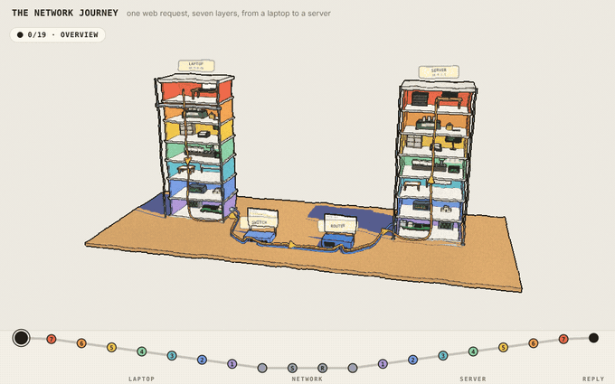

# The Network Journey



Follow one web request (`GET /` from a laptop at 10.0.0.20 to `wiki.lan` at 10.0.1.7) through the seven layers of the
OSI model: down the laptop, across a cable, a switch, a router and a second cable, up the server, and back again as the
reply. Twenty stops, one step at a time, with the real bytes at every step.

**Live: [osi-flow.netlify.app](https://osi-flow.netlify.app/)**

## Using it

One control: **Next / Back** (or the arrow keys, or click a stop on the route map at the bottom). Drag the picture to
look around; double-click to reset the view.

Every stop has the same parts: what the layer does in one sentence, the same step in everyday terms (posting a letter),
what happens here, the message as it is right now (click a header block to see its fields; point at a field to find it
in the bytes), who does this in real systems, and one thing to try:

| Stop | Try it |
|---|---|
| Laptop 7 Application | edit the path; byte counts and checksums change all the way through |
| Laptop 6 Presentation | peek at the decrypted bytes, encrypt again |
| Laptop 5 Session | replay the TLS handshake |
| Laptop 4 Transport | switch TCP / UDP (carries through the rest of the trip) |
| Laptop 3 Network | pick a destination: local delivery or the default gateway |
| Laptop 2 Data link | clear the ARP cache and ask again |
| Laptop 1 Physical | unplug the cable |
| Cable | add a burst of noise (a flipped bit) |
| Switch | forget the MAC table (flooding) |
| Router | pick a destination: which routing-table row wins |
| Server 2 Data link | flip one bit: the recomputed CRC-32 no longer matches the FCS |
| Server 4 Transport | lose the segment: TCP retransmits, UDP doesn't |
| Server 6 Presentation | tamper with one byte: the TLS tag check fails |
| The reply | play the reply again: down the server, back across the network, up the laptop |

Nothing is made up: the TLS record lengths, the TCP/UDP checksum, the IP header checksum (recomputed when the router
lowers the TTL from 64 to 63), the Ethernet FCS (CRC-32) and the new MAC addresses after the router are all computed
from the actual bytes.

## Running it

Open `src/index.html` in a browser. It works offline, with no build step and no server.

To build what gets deployed: `python3 scripts/build_site.py` writes `dist/index.html` and
`dist/assets/three-<hash>.min.js`. Serve `dist/` with any static server, e.g. `python3 -m http.server -d dist`.

## Deploying

The site is hosted on Netlify at [osi-flow.netlify.app](https://osi-flow.netlify.app/). `netlify.toml` tells Netlify to
run `python3 scripts/build_site.py` (Python 3 only, nothing to install) and publish `dist/`. Netlify builds a deploy
for every push, and a preview for every branch and pull request.

Load time: the page is about 40 KB and three.js about 120 KB after compression. three.js is trimmed to only the parts
the page uses, and its file name carries a content hash, so Netlify tells browsers to cache it for a year.
A loader shows only if loading takes longer than a moment.

## Project layout

```
src/index.html            the whole app: HTML, CSS and JavaScript; each stop is plain data in CONTENT
src/vendor/three.min.js   three.js r158, trimmed to the parts the page uses
scripts/build_site.py     builds dist/ for deployment
scripts/build_three.sh    rebuilds the trimmed three.js (only needed if the page uses a new part of three.js)
scripts/record_gif.js     re-records docs/journey.gif (needs Playwright and ffmpeg):
                          python3 scripts/build_site.py && node scripts/record_gif.js
```

## Look

The drawing style is [Colorfigures](https://april-zhu.com/colorfigures) (the skill vendored in
`.claude/skills/colorfigures`) carried into 3D: every colour has three flat tones (light, mid, dark) picked by a light
that stays put relative to the viewer; heavy ink silhouettes and finer inner lines; a gentle hand-drawn wobble and paper
grain; and a flat blue cast shadow on a wooden desk board. The ink, wobble and grain are one full-screen pass over the
rendered scene (`INK_PASS` in `src/index.html`).

## Credits

3D by [three.js](https://threejs.org) (MIT License, `src/vendor/three.LICENSE`). Drawing style from
[Colorfigures](https://april-zhu.com/colorfigures) by April Zhu (MIT).
